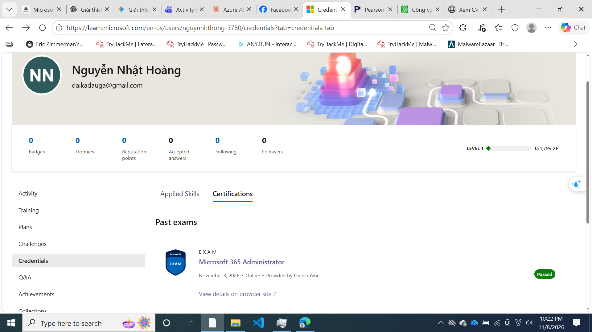

# 🏆 Thành tích

## Microsoft 365 Certified: Administrator Expert (MS-102)

- **Kỳ thi:** MS-102: Microsoft 365 Administrator
- **Trạng thái:** Đã đạt bài thi (Pass)
- **Chứng chỉ:** Chưa được cấp. Chứng chỉ Expert yêu cầu hoàn thành thêm một chứng chỉ trung cấp (Associate) đi kèm, và phần này hiện vẫn đang được hoàn thiện.
- **Hạn hoàn thành dự kiến:** Cuối tháng 11/2026

Kết quả đạt bài thi MS-102:

---

*Cập nhật lần cuối: 11/2026. Sẽ bổ sung chứng chỉ chính thức khi đã hoàn thành.*
